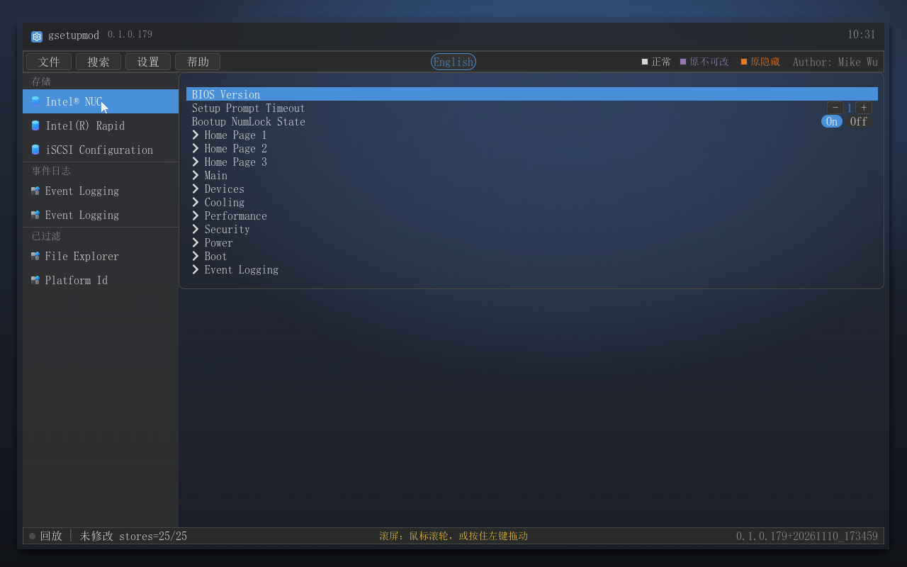
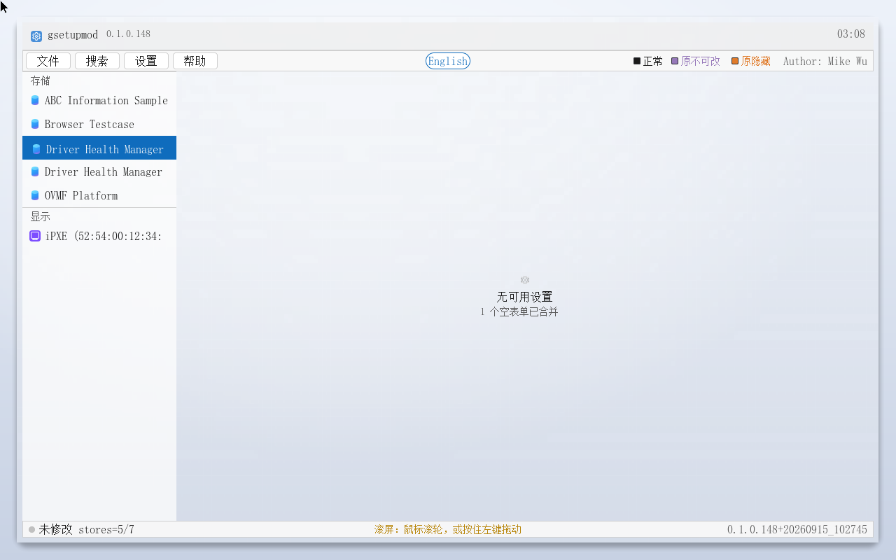
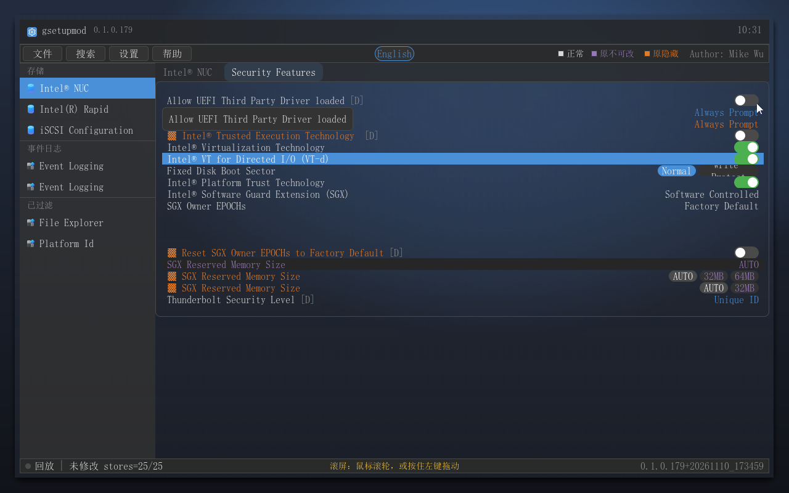
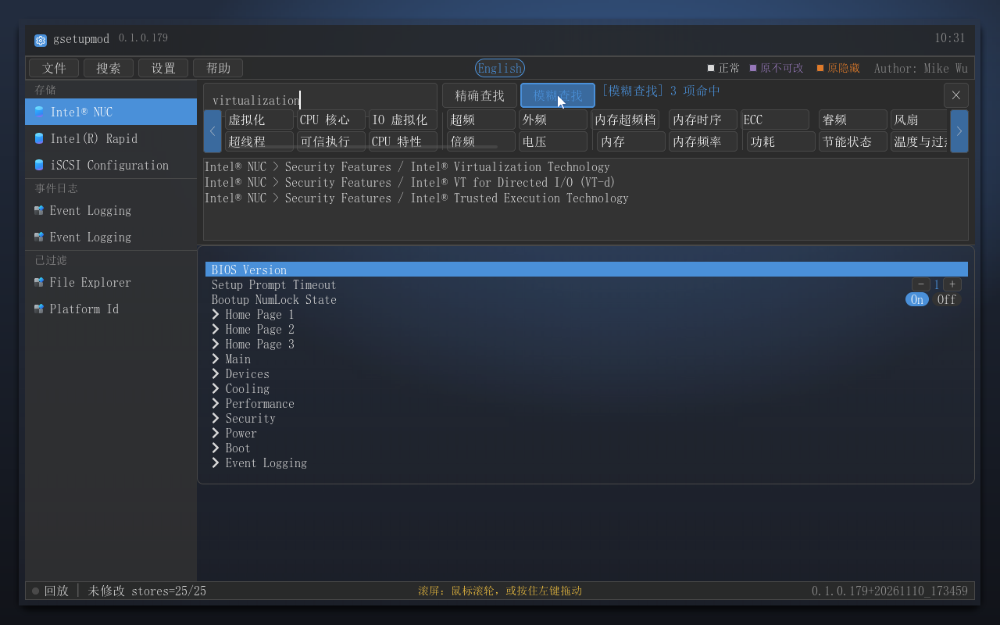
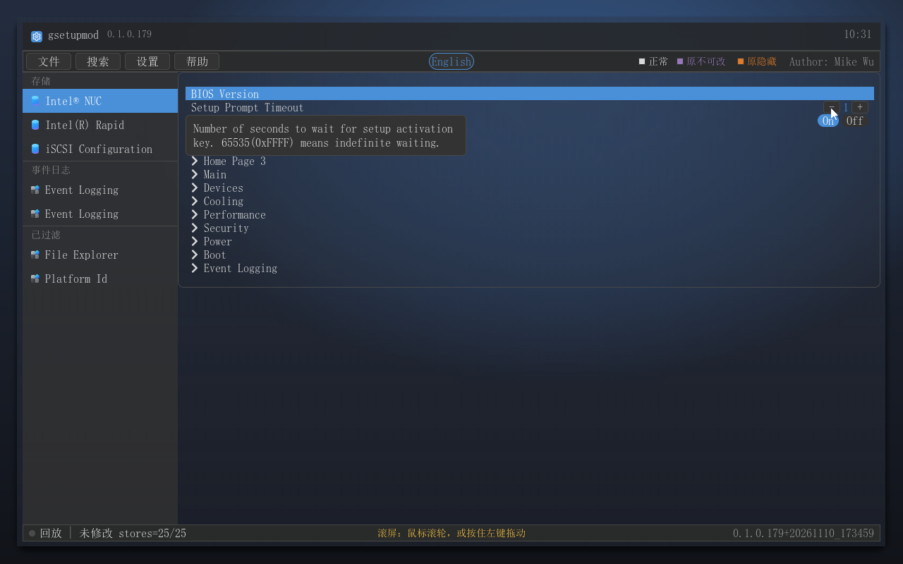
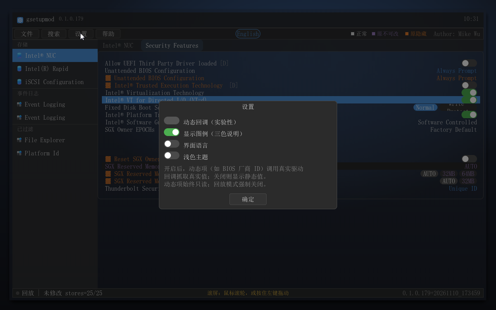
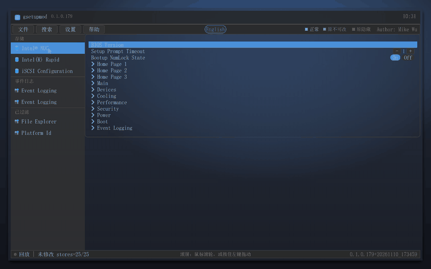

# gsetupmod — 固件设置浏览器：把 BIOS 里被藏起来的选项，全部打开给你看

> **gsetupmod** 是一款运行在 UEFI 固件环境下的图形化固件设置浏览器（原生 UEFI 应用，无需操作系统、不依赖 Shell）。它从运行中的固件里解析全部 HII/IFR 设置数据，以 Windows 11 风格的**毛玻璃**界面重建 BIOS Setup——**包括被固件刻意隐藏的选项**。修改经固件变量接口写回，重启一次生效。
>
> **License**：免费授权个人用户使用；商业使用请联系作者（Author: Mike Wu）。商业用途包括但不限于：商用整机预装、付费服务分发、企业内网部署获利等场景。

## ✨ 重点推荐功能

### 1. 🔍 想开虚拟化却找不到？现在可以用"你脑子里的词"搜了（本次更新）

**客户最常卡住的一步不是"改不了"，而是"找不到"。** 想开 CPU 虚拟化，脑子里是"虚拟化"，固件里写的却是 `Intel Virtualization Technology` / `VT-d` / `SVM Mode` —— 词对不上，精确搜索一条都不中；而多数人连 `VT` 这个缩写都不知道。

这一版把搜索拆成**两个并排的常驻按钮**：`精确查找`（原来的子串搜索，行为逐字不变）与 `模糊查找`，按哪个就是哪种。

- **模糊模式**做归一化（大小写、连字符、点号：`VT-x` = `VT x` = `VTX`，`X.M.P` = `XMP`）、词边界匹配、拼写容错（编辑距离 ≤1，`Virtulization` 也能中）、同义词扩展与相关度排序；
- **模糊结果恒为精确结果的超集** —— 原词子串命中永远排在最前，只多不少；
- **51 个概念 chip** 分 9 组铺在第二行，**中文只显示在按钮上，一个字都不用打**：虚拟化 / 超线程 / 超频 / 内存频率 / 安全启动 / 风扇 / 充电阈值 / SGX-TDX / SR-IOV …… 点一下即用整组别名检索（点「虚拟化」= 同时搜 `VT-x` `VT-d` `SVM` `IOMMU` `英特尔虚拟化技术`）；chip 条两端有 `<` `>` 按钮，滚到内容边界即停，不会滚进空白；
- **扫描有进度**：结果区底部一条进度条 + 状态 `模糊查找中 N/M…`，输入 140 ms 防抖（连打只查最后一次，不逐键重扫），大机型不再"像死机"；
- 词表**内置在程序里**：不联网、不需要中文输入法、不依赖任何外部文件。

真机 NUC 数据实测同一个词 `virtualization`：**精确 2 条**（Virtualization Technology、VT-d），**模糊 3 条**（多出 Trusted Execution Technology，走同义词别名）—— 差异一眼可见。

### 2. ⌨️ 纯键盘：Tab 焦点在三个区之间**首尾成环**

**客户拿纯键盘跑了一整轮，报回来的问题这次全部修完。** 焦点区（左栏 → 表单区 → 菜单栏）现在连成一个环：**菜单栏走到最后一个按钮再按 Tab，直接绕回左栏**；Shift+Tab 反向同一条路，任何一区都不会"进得去出不来"。**展开的菜单下拉里，Tab 与 Shift+Tab 等同 ↓ 与 ↑**（在菜单项之间移动，自动跳过置灰项），ESC 关掉下拉。

**对话框里的 Tab 只在对话框自己的控件之间循环**，不会跑到背后暗掉的主界面上——写回预览、设置、搜索面板、文件对话框都一样；**列表整体算一个 Tab 位，列表里的行用 ↑↓ 走**（文件对话框因此从 20 个 Tab 位收到 5 个：盘符 / 文件列表 / 文件名 / 确定 / 取消）。

### 3. 🖱️ 鼠标：**固件没有鼠标驱动，插上鼠标照样能用**

多数固件工具在"固件本身不带 USB 鼠标驱动"的机器上（精简固件、部分 ARM 平台、裸跑在虚拟机里的固件）会变成纯键盘工具——鼠标插着也没反应。**gsetupmod 探测不到指针设备时，会自己加载一个内建 USB HID 鼠标驱动**，按标准 UEFI 指针协议发布给界面，插上普通 USB 鼠标即可移动、点击、悬停。

**滚轮也一并接通**：翻长表单不必再按住拖动；不带滚轮的鼠标仍可按住左键拖动滚动。固件自带指针驱动时直接用（两条路径都实现了滚轮 Z 轴解析），状态栏中间的提示写的就是这两条。

### 4. 被固件隐藏的选项——全部展示，还能改

标准 BIOS 只显示"厂商愿意给你看"的那一面：被 `SUPPRESS_IF` 规则隐藏的选项（想开 VT 却找不到入口的经典场景）、被 `GRAY_OUT_IF` 禁用的选项，从数据层面就被抹掉了。gsetupmod 对隐藏规则按真实 IFR 字节求值，三种颜色一目了然：

| 颜色 | 语义 |
|---|---|
| 白 | 正常设置，可修改 |
| 紫 | 固件中原本不可改（灰显），值可读 |
| 橙 | 固件中原本隐藏（SUPPRESS_IF），▓ 标记，可浏览可修改 |

图例常驻菜单栏右上角。真机 NUC 数据实测：`Intel® Trusted Execution Technology`、`SGX Reserved Memory Size` 等标准 Setup 中不存在的项全部呈现。

### 5. 搜索——"想开 VT 找遍 BIOS 没有"？搜 "VT" 两秒直达，不知道 VT 也能搜

`Ctrl+F` 打开搜索面板，输入即过滤，**隐藏项同样可搜**，回车跳转目标行并 ACCENT 闪烁定位。面板分三行：第一行输入框 + `精确查找` / `模糊查找` 两个按钮 + 常驻状态（`[精确查找] N 项命中`，0 命中也显示）+ 关闭；第二行 51 个概念 chip（两端 `<` `>` 滚动）；第三行结果列表。

索引覆盖问题行、跳转行、帮助文本，以及 `My CPU Speed is` 这类纯文本行 —— 所以搜 `CPU` 也能命中那些只作说明出现的行。

### 6. 悬停 1 秒——每个选项自带说明书

设置项的固件帮助文本（范围、含义、警告）做成**悬停 1 秒弹出的小气泡**，移走即消失，不拦截点击。

### 7. 深 / 浅两档毛玻璃外观

界面是 Win11 风格的**毛玻璃**：主窗体四周留边、浮在按运行时分辨率生成的渐变壁纸之上，铬面（品牌条 / 菜单栏 / 状态栏 / 左栏 / 页签条）半透明、内容区只留极淡底色，壁纸的渐变与模糊整个透出来。**深色（默认）与浅色两档**整档切换（壁纸、玻璃叠色、文字与标记色），选择写入配置文件 `\gsetupmod.cfg`，重启后生效。对话框与弹层的进出场还带**转场动效**（按对象类型选不同效果）。

## 🚀 下载与使用

- **Release 下载**（推荐）：https://github.com/MikeWuPing/gsetupmod/releases —— 含
  - `gsetupmod.efi`：应用本体（x64 的 UEFI 二进制）；`gsetupmod-aarch64.efi`：ARM64 版；
  - `gsetupmod-boot-<版本>.iso`：**双架构 U 盘启动 ISO（Ventoy 兼容）**——内置引导 ESP 适配 Ventoy/VMware/真机：拷进任何 FAT32 U 盘（`EFI` 目录在盘根）或直接刻盘；**本版把内嵌引导 ESP 精简到 5 MB，整张 ISO 从 20.5 MB 减到 10.5 MB**；**使用 Ventoy 启动时请选菜单第一项「正常模式」（Normal Mode）**（已验证可用；GRUB2 模式暂不受支持）；
  - 中文说明书（Word，简版 + 详版；在线 Markdown 见下方「文档」）。
- **使用步骤**：
  1. 进入 BIOS/UEFI 设置，**关闭 Secure Boot**（安全启动会拒载未签名镜像；用后建议恢复）；
  2. 从 U 盘/ISO 启动（UEFI 模式），固件直接加载应用，几秒进入界面；
  3. 左栏选表单 → 悬停看帮助 → `Ctrl+F` 搜索 → 改完「文件 → 保存并退出」→ 重启生效。
- 完整演示动图（8 帧，载入真机 dump 后的巡览：主界面 → 悬停帮助 → 精确搜索 2 条 → 切模糊 3 条 → chip 横向卷动 → 跳转高亮 → 三色表 → 设置对话框；477 KB）：

## 📚 文档

| 文档 | 说明 |
|---|---|
| [产品说明书（详版）](docs/manual/gsetupmod-产品说明书-详版.md) | 面向进阶用户与固件工程师：架构、三色语义、全部功能、深浅主题与鼠标支持、分辨率自适应、FAQ |
| [产品说明书（简版）](docs/manual/gsetupmod-产品说明书-简版.md) | 面向普通用户的功能图文速览 |

（Word 版见 Release 附件。）

## 📋 主要特性

- **模糊搜索**（本次更新）：`精确查找` / `模糊查找` 两个并排按钮、51 个概念 chip（9 组）、同义词表内置不联网、模糊结果恒为精确的超集、扫描带进度条与 140 ms 防抖；
- **指针/触摸更稳**：固件没填"每毫米计数"（`Resolution=0`）时按 1 计数 = 1 像素兜底，位移不再被整体丢弃（"光标画得出却钉住不动"那一类）；指针实例分层（固件实例优先于内建兜底实例）、绝对坐标按设备实际量程归一、选中后复位一次并带两条诊断日志；
- **纯键盘全可用**：Tab 在左栏 / 表单区 / 菜单栏之间**成环换区**（菜单栏末按钮绕回左栏），↑↓ 区内移动，下拉内 Tab 等同 ↓↑，**对话框内 Tab 只在框内控件之间循环**；
- **鼠标全支持**：**固件无鼠标驱动时由内建 USB HID 驱动接管**；滚轮滚动；无滚轮可按住左键拖动；
- **毛玻璃界面 + 深/浅两档主题**（选择持久化到 `\gsetupmod.cfg`），对话框与弹层带转场动效；
- **完整 HII 枚举**：汇总全部固件驱动注册的设置表单，几十个 formset 一个界面；
- **隐藏项展示+修改**（独家）、三色语义、真实 IFR 表达式求值；
- **全量搜索**（隐藏项可搜，索引含问题行 / 跳转行 / 帮助文本 / 纯文本行）、**悬停帮助**；
- **图形化编辑**：勾选滑轨 / 单选胶囊与列表 / 数值步进器 / 文本面板，鼠标键盘双通道；
- **按需写回**：只写实际改过的变量（未改动整体跳过），逐项报告，`Security Violation` 点名；
- **快照与 .gus**：全量快照一键恢复；整机 HII 环境导出成 `.gus` 文件，任何机器载入回放（离线分析、回放禁写）；
- **X64 / AArch64 双架构**：同一份源码构建，启动介质同时带 `BOOTX64.EFI` 与 `BOOTAA64.EFI`；
- **分辨率自适应**：力争 ≥1280×800，高分屏上界面铺满可用区（不留大片空白），低分辨率降级提示；
- **无需 Shell**：固件直启 `EFI/BOOT/BOOTX64.EFI`，没有 Shell 的机器一样能跑；
- 右上**版本**与**作者标识**（Mike Wu）常驻界面。

## ⚠️ 注意事项

- **Secure Boot**：未签名镜像需关闭安全启动（上表步骤 1）；
- **部分变量被固件锁定**：`SetVariable` 返回 `Security Violation` 的项会逐名报告——那是固件有意保护（如 OEM 变量），不是写坏；
- **改动生效时机**：多数设置变量由固件启动阶段读取，写回后重启一次生效；
- **免责**：修改固件设置有一定风险，请在快照备份后操作；作者不对错误修改造成的硬件/数据损坏负责。

## 🤝 联系与授权

- 作者：**Mike Wu**
- **免费授权个人用户使用**；商业使用（商用整机预装、付费服务、企业部署获利等）请先联系作者获取授权。
- 建议、BUG 反馈与"想开某个选项却找不到"的机器型号，欢迎到 [Issues](https://github.com/MikeWuPing/gsetupmod/issues) 提交。

## 兄弟项目

- [gudumpinfo](https://github.com/MikeWuPing/gudumpinfo) —— 图形化 UEFI 系统信息查看器（Handle/Protocol/PCI/ACPI/SMBIOS/CPUID…）
- [UEFI_Test_Suite](https://github.com/MikeWuPing/UEFI_Test_Suite) —— UEFI 硬件诊断工具套件
- [guedit](https://github.com/MikeWuPing/guedit) —— UEFI Shell 下的图形化文本编辑器（LVGL）
- [gufile](https://github.com/MikeWuPing/gufile) —— UEFI Shell 下的 GUI 文件管理器（Explorer 式界面）
- [mount](https://github.com/MikeWuPing/mount) —— UEFI Shell 挂载工具：NTFS/ext4/ISO 卷挂载与 ISO 虚拟块设备

---

## English Summary (英文摘要)

**gsetupmod — a UEFI firmware settings browser that shows you every option your BIOS hides.**

- **Fuzzy search (this update).** Exact and fuzzy are now two side-by-side buttons. The fuzzy pass normalizes case and punctuation (`VT-x` = `VT x` = `VTX`), enforces word boundaries, tolerates one-character typos, expands through a built-in 51-concept synonym table (9 groups, Chinese + English labels rendered as clickable chips — no IME, no network) and ranks by relevance. Results are **always a superset of the exact pass**, and the scan shows a progress bar with 140 ms debounce. Fuzzy hits never drop an exact hit.
- **Steadier pointer & touch input.** Some firmware publishes relative pointer devices without the counts-per-millimetre metadata (`Resolution`), and the spec defines 0 as "this axis does not exist" — the old logic dutifully zeroed every movement, so the cursor was painted but never moved. The app now falls back to 1 count = 1 pixel and logs a warning. The earlier hardening stays: tiered pointer instances (firmware-provided devices always outrank the app's own built-in fallback), absolute coordinates normalized over the device's declared range, and a one-shot reset plus two diagnostic log lines.
- **Fully keyboard-drivable.** Tab cycles left navigation → form area → menu bar as a **closed loop** (Tab on the last menu button wraps back to the left column; Shift+Tab reverses it), arrows move within a pane, Tab inside an open menu behaves like ↓/↑, and **inside a dialog Tab stays within that dialog's own controls** (a list counts as one stop; its rows are walked with ↑/↓).
- **Mouse always works — even when the firmware ships no mouse driver.** When no pointer device is found, gsetupmod loads its own built-in USB HID mouse driver and publishes it as a standard UEFI pointer, so an ordinary USB mouse just works; the **scroll wheel** is wired through as well (drag-to-scroll still there for wheel-less mice).
- Native UEFI application: no OS, no Shell — the firmware loads `EFI\BOOT\BOOTX64.EFI` (or `BOOTAA64.EFI` on ARM64) directly from a FAT32 USB stick/ISO. The boot ISO's embedded ESP is slimmed to 5 MB — the whole ISO shrank from 20.5 MB to 10.5 MB.
- Rebuilds the whole BIOS Setup from the firmware's live HII/IFR data, **including items the firmware hides** (orange `▓`) or disables (purple) — all readable and modifiable.
- **Frosted-glass UI with dark and light theme packs** (persisted to `\gsetupmod.cfg`), plus entry transitions for dialogs and overlays.
- **Ctrl+F search** indexes everything (hidden items, help text and plain text rows too): type "VT" to jump straight to Intel Virtualization Technology even if the standard Setup never shows it — or type "virtualization" if you never knew the acronym.
- **Hover 1 s** to see each option's own firmware help text.
- **Write-back only what you changed**; per-item error report (firmware-locked variables are named, e.g. `Security Violation`); full snapshot & `.gus` env export/replay for offline analysis.
- **X64 / AArch64** from the same sources; boot media carries both. Resolution-adaptive (≥1280×800, fills the available area on high-resolution screens, graceful fallback below 800×600).
- **License**: free for personal use; **commercial use requires contacting the author (Mike Wu)**.
- ⚠️ Secure Boot must be OFF (unsigned image).

## Sister Projects

The developer's other UEFI series tools:

- [gsetupmod](https://github.com/MikeWuPing/gsetupmod) — Firmware settings browser: rebuild BIOS Setup by parsing HII/IFR, exposing hidden options
- [UEFI_Test_Suite](https://github.com/MikeWuPing/UEFI_Test_Suite) —— UEFI hardware diagnostics, testing and repair-assist tools
- [guedit](https://github.com/MikeWuPing/guedit) — GUI text editor for UEFI Shell (LVGL)
- [gufile](https://github.com/MikeWuPing/gufile) — GUI file manager for UEFI Shell (Explorer-style)
- [mount](https://github.com/MikeWuPing/mount) — UEFI Shell mount tool: NTFS/ext4/ISO volume mounting and ISO virtual block devices

---

[产品说明书（详版）](docs/manual/gsetupmod-产品说明书-详版.md) · [产品说明书（简版）](docs/manual/gsetupmod-产品说明书-简版.md) · [Releases](https://github.com/MikeWuPing/gsetupmod/releases)
